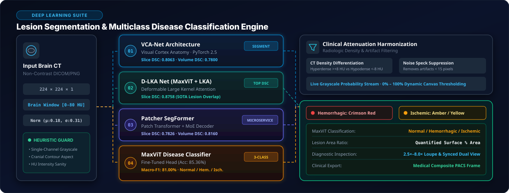
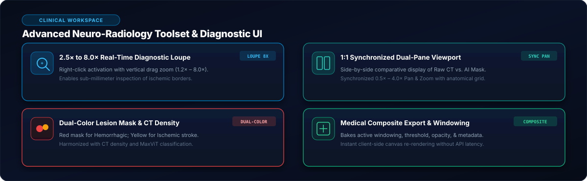
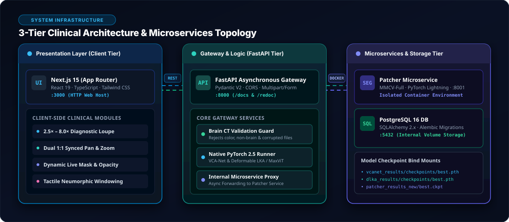
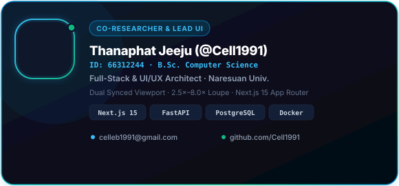

<div align="center">

<!-- Animated Medical Hero Banner -->


<br/><br/>

[](https://nextjs.org/)
[](https://react.dev/)
[](https://fastapi.tiangolo.com/)
[](https://pytorch.org/)
[](https://www.postgresql.org/)
[](https://www.docker.com/)
[](https://typescriptlang.org/)
[](https://tailwindcss.com/)

<br/>

<p align="center">
  <b>Detection and Localization of Brain Stroke Lesions in CT Images Using Deep Learning</b><br/>
  <i>Bachelor of Science Program in Computer Science · Department of Computer Science and Information Technology</i><br/>
  <i>Faculty of Science, Naresuan University · Semester 2, Academic Year 2568 (2026)</i>
</p>

<!-- Animated Medical Divider -->


</div>

---

## 1. Research Background & Clinical Significance

**NU Stroke Scan** is an artificial intelligence-driven **Clinical Decision Support System (CDSS)** developed as an undergraduate senior research thesis in Computer Science at Naresuan University.

Stroke represents one of the leading global causes of mortality and long-term disability (World Health Organization, 2023, 2025). In Thailand, stroke remains a severe public health crisis, being one of the top causes of death and imposing an immense economic burden on healthcare facilities and patient families (Ministry of Public Health Thailand, 2022). Stroke is classified into two primary pathological forms:
1. **Ischemic Stroke**: Cerebral arterial occlusion resulting in restricted blood supply, acute tissue ischemia, and cytotoxic edema (~85% of cases).
2. **Hemorrhagic Stroke**: Rupture of cerebral blood vessels causing acute intracranial bleeding and hematoma expansion (~15% of cases).

Rapid differential diagnosis between these two conditions is paramount: administering intravenous thrombolytic therapy (such as recombinant tissue plasminogen activator [rtPA]) to an ischemic stroke patient can restore cerebral perfusion and save brain tissue, whereas administering thrombolysis to a patient with hemorrhagic stroke is catastrophic and often fatal (Powers et al., 2019).

In acute emergency admissions, **Non-Contrast Computed Tomography (NCCT)** of the head is the universal first-line imaging modality due to its rapid acquisition time and high sensitivity to acute intracranial hemorrhage (Wardlaw et al., 2014). However, interpreting acute NCCT scans relies heavily on the availability and experience of radiologists. Clinical challenges include:
- Subtle, low-contrast attenuation differences in hyperacute ischemia that can be easily missed.
- High inter-observer diagnostic variability among non-specialist clinicians during emergency off-hours.
- Severe cognitive workload and interpretation fatigue under tight time-to-treatment windows.

To address these challenges, this study designs, trains, benchmarks, and deploys a multi-model deep learning platform capable of verifying image modality, classifying stroke subtype, accurately segmenting acute lesion boundaries, and presenting diagnostic findings through an interactive radiological web workstation.

---

<!-- Animated Medical Divider -->
<div align="center">
  
</div>

## 2. Research Objectives & Scope

### 2.1 Research Objectives
1. **Deep Learning Architecture Comparison**: To implement, adapt, and quantitatively compare multiple state-of-the-art deep learning segmentation architectures (**D-LKA Net**, **VCA-Net**, and **Patcher SegFormer**) on brain CT images under identical experimental conditions using standard clinical metrics (Dice Similarity Coefficient [DSC] and Intersection over Union [IoU]).
2. **Clinical Prototype Web Application**: To engineer and evaluate a full-stack prototype web application (**NU Stroke Scan**) that accepts uploaded CT slices, executes deep learning inference (modality validation, 3-class disease classification, and lesion segmentation), provides radiological windowing calibration with real-time dynamic thresholding, and exports standardized clinical reports.

### 2.2 Scope of the Research
- **Data Scope**: 2D axial Non-Contrast Brain CT slices ($512 \times 512$ pixel matrix downsampled to $224 \times 224$ for neural network input). Sourced from the Brain Stroke CT Dataset published on Kaggle (`ozguraslank/brain-stroke-ct-dataset`), a public redistribution of the de-identified clinical CT collection reported by Qari & Thafar (2025) comprising 6,650 images (1,130 ischemic, 1,093 hemorrhagic, 4,427 normal). Excludes non-imaging clinical data (age, sex, vitals, laboratory panels).
- **Disease Type Scope**: Differentiating acute Ischemic Stroke, acute Hemorrhagic Stroke, and Normal brain CT scans. Excludes non-stroke intracranial pathologies such as neoplasms, aneurysms, and traumatic brain injury.
- **Technical & Model Scope**: Single-channel 2D slice processing; 3 segmentation architectures (D-LKA Net, VCA-Net, Patcher); 1 disease-type classification model (MaxViT); 1 input modality validation model (ResNet-18).
- **Application Scope**: Prototype decision support tool designed to assist qualified healthcare professionals; not integrated into hospital PACS/HIS networks or deployed for standalone autonomous clinical diagnosis.

---

<!-- Animated Medical Divider -->
<div align="center">
  
</div>

## 3. Related Theory & Literature Review

Table 2.2 from the thesis outlines seminal research and comparative models evaluated in this domain:

| No. | Study / Researcher (Year) | Research Focus | Architectures & Methodologies | Modality | Benchmark Performance |
| :---: | :--- | :--- | :--- | :---: | :--- |
| **1** | **Kaewlek et al. (2024)** | Segmentation & Classification Web App | U-Net (skull stripping / brain extraction) + VGG-16 (stroke classification). Web app supporting multiple formats, PDF export, and email dispatch. | CT | **Accuracy: 96.9%** (Sensitivity: 95.2%, Specificity: 97.8%) |
| **2** | **Malik et al. (2024)** | Comprehensive Literature Review | Systematic review of 28 deep learning stroke segmentation studies (2018–2023). Found 71% utilized MRI and 29% utilized CT. | MRI / CT | Identified U-Net variants, Transformers, and preprocessing impacts. |
| **3** | **Li (2021)** | Stroke Lesion Segmentation | **VCA-Net**: Emulates ventral visual stream (V1, V2, V4, IT bottleneck) with Inception and parallel convolution paths on ATLAS MRI. | MRI | **Dice: 0.8449** (ATLAS v1.0 benchmark) |
| **4** | **Ou et al. (2023)** | Precise Lesion Segmentation | **Patcher**: 4-stage Patch Transformer encoder ($32 \times 32$ groups, 8px overlap, $2 \times 2$ patch tokens) + Mixture-of-Experts (MoE) gating decoder. | MRI | **Dice: 0.8832** (Acute ischemic stroke MRI) |
| **5** | **Azad et al. (2023)** | Multi-Organ & Lesion Segmentation | **D-LKA Net**: Hierarchical MaxViT encoder + Deformable Large Kernel Attention decoder with adaptive receptive fields. | CT / MRI | **Dice: 0.8427** (Synapse multi-organ CT) |
| **6** | **Qari & Thafar (2025)** | Multiclass Stroke Classification & XAI | **MaxViT** + Conditional GAN (cGAN) augmentation + Grad-CAM++ saliency heatmaps on 6,650 CT scans. | CT | **Accuracy: 98.00%**, F1-score: 98.00%, AUC: 99.75% |
| **7** | **Zafari-Ghadim et al. (2024)** | Architecture Comparison Benchmark | Rigorous comparison of D-LKA, LKA, DAE-Former, FCT, and nnU-Net on ISLES 2022 and ATLAS v2.0 MRI datasets. | MRI | **Aggregated Dice: 0.886** (ISLES 2022, nnU-Net), 0.871 (D-LKA) |

### Research Gap & Rationale
While VCA-Net and Patcher achieved strong segmentation metrics on MRI (T1, eADC, DWI sequences specifically engineered for tissue diffusion contrast), and D-LKA Net excelled on high-contrast abdominal CT organs, none had been benchmarked directly on **low-contrast Non-Contrast Brain CT stroke scans**. CT measures X-ray attenuation in Hounsfield Units where early ischemic edema produces subtle hypodensity ($\Delta\text{HU} \approx 5\text{--}15\text{ HU}$) against surrounding brain parenchyma. As demonstrated by Zafari-Ghadim et al. (2024), architectural complexity alone does not guarantee superior segmentation; preprocessing consistency, controlled training, and objective comparative benchmarking are paramount.

---

<!-- Animated Medical Divider -->
<div align="center">
  
</div>

## 4. Preprocessing Pipeline (Unified 5-Step Protocol)

To eliminate data leakage and ensure an unbiased benchmark across all three architectures, a unified 5-step preprocessing pipeline was implemented in Python and executed via `pipeline/main.py`:

```
Raw CT Scans ➔ [Step 1: CT Windowing (WL:40, WW:80 HU)] ➔ [Step 2: HSV Mask Extraction]
             ➔ [Step 3: Case-Level Patient Split (70/15/15)] ➔ [Step 4: Resize (224×224) & Normalization]
             ➔ [Step 5: Offline Albumentations Augmentation] ➔ .npy Tensors + manifest.csv
```

1. **Step 1: CT Windowing**: Raw pixel values are converted to Hounsfield Units (HU) using DICOM header metadata (`RescaleSlope` and `RescaleIntercept`). Values are clipped to the standard non-contrast brain window ($\text{Window Level [WL]} = 40\text{ HU}$, $\text{Window Width [WW]} = 80\text{ HU} \implies [0, 80]\text{ HU}$) and stretched to an 8-bit grayscale matrix ($0\text{--}255$).
2. **Step 2: HSV Mask Extraction**: Lesion masks are extracted from dataset annotation overlays via saturation thresholding in HSV color space (lesion fill is red for both ischemic and hemorrhagic classes, while class identity is preserved via folder hierarchy).
3. **Step 3: Case-Level Patient Split**: Partitioned into **Training (70%)**, **Validation (15%)**, and **Test (15%)** sets using a fixed random seed of `42`. Splitting is performed strictly at the **patient case level** (using patient case identifiers) rather than the individual slice level, preventing slice-level data leakage between adjacent CT cuts of the same individual (Tampu et al., 2022).
4. **Step 4: Resize & Normalization**: All slices and binary masks are resized to $224 \times 224$ pixels and normalized using the training set empirical distribution ($\mu = 0.179$, $\sigma = 0.307$).
5. **Step 5: Offline Data Augmentation**: Applied exclusively to the training set using the Albumentations library (random rotation $\pm 15^\circ$, random scaling $0.9\text{--}1.1$, random translation $\pm 10\%$, and horizontal flip with $p=0.5$). Bilinear interpolation is used for scans and nearest-neighbor interpolation for masks.

### Dataset Partitioning Summary (Table 4.1)

| Data Split | Patient Cases | Processed Slices | Purpose & Augmentation Status |
| :--- | :---: | :---: | :--- |
| **Training Set** | 4,655 | 9,310 | 70% of dataset; offline Albumentations augmentation applied |
| **Validation Set** | 998 | 998 | 15% of dataset; used for learning rate scheduling & checkpoint selection |
| **Test Set** | 997 | 997 | 15% held-out test split for disease classification evaluation |
| **External Test Set** | 199 | 199 | Independent held-out test set (35 lesion-positive, 164 no-lesion) for segmentation benchmark |

---

<!-- Animated Medical Divider -->
<div align="center">
  
</div>

## 5. Deep Learning Architecture Suite

<!-- Custom High-Definition SVG Models Suite -->


<br/>

### 5.1 Segmentation Architectures & Adaptations
Following the benchmark framework of Zafari-Ghadim et al. (2024), core optimization hyperparameters were held constant across all three models: **SGD optimizer**, **initial learning rate $0.05$**, **100 epochs**, **batch size 8**, input resolution $224 \times 224$, and fixed seed `42` on cloud **NVIDIA A100 SXM4 80GB GPUs** via Docker containers. Loss functions were kept faithful to each architecture's published formulation:

- **D-LKA Net (Deformable Large Kernel Attention Network)** (Azad et al., 2023):
  - *Encoder*: 4-stage hierarchical MaxViT backbone ($[2, 2, 5, 2]$ blocks) extracting multi-axis local grid and global axial attention at resolutions $H/4, H/8, H/16, H/32$.
  - *Decoder*: 4-stage 2D D-LKA blocks with deformable convolution kernels that dynamically offset sampling positions to fit irregular, amorphous stroke boundaries.
  - *Adaptations*: Replaced 3D volume loader with 2D CT slice loader; altered output head from 9 multi-organ classes to 1 binary logit; used fused $\mathcal{L}_{\text{D-LKA}} = 0.6 \cdot \mathcal{L}_{\text{Dice}} + 0.4 \cdot \mathcal{L}_{\text{BCE with Logits}}$; trained from scratch with `torch.compile()` and `bfloat16` autocast.
- **Patcher SegFormer (Patch Transformer + MoE Decoder)** (Ou et al., 2023):
  - *Encoder*: 4 stacked Patcher blocks partitioning the image into overlapping $32 \times 32$ groups (8px padding) and $2 \times 2$ patch tokens passed into Vision Transformers to capture fine-grained and global context simultaneously.
  - *Decoder*: 4-level Mixture-of-Experts (MoE) convolutional gating network computing per-pixel expert weights.
  - *Adaptations*: Converted 2-channel input (eADC/DWI) to single-channel CT; resized input to $224 \times 224$; configured output to 1 channel with sigmoid thresholding; loss formulation $\mathcal{L}_{\text{Patcher}} = \mathcal{L}_{\text{BCE}} + \mathcal{L}_{\text{IoU}}$; executed within an isolated microservice container running PyTorch 1.12.1 and `mmcv-full < 2.0`.
- **VCA-Net (Visual Cortex Anatomy Alike Neural Network)** (Li, 2021):
  - *Architecture*: Emulates the ventral visual pathway: V1 block (6 convolutional layers with 4 parallel sub-paths), V2 block (Inception multi-scale feature extraction), V4 block (multi-scale feature integration), and Inferior Temporal (IT) bottleneck with 4 upsampling blocks.
  - *Adaptations*: Integrated custom `CTDataset` loader; eliminated double-sigmoid calculation by replacing `BCEWithLogitsLoss` with `BCELoss`; added value clamping to EML Loss for numerical stability in mixed precision; corrected learning rate scheduler mode to maximize validation Dice; trained with `torch.compile()` and `bfloat16` autocast.

### 5.2 Supporting Classification Models
- **Disease Type Classifier (MaxViT)**: Categorizes scans into **Normal**, **Hemorrhagic Stroke**, and **Ischemic Stroke**. Utilizes `maxvit_base_tf_224` (ImageNet-pretrained via `timm`). Evaluated with discriminative fine-tuning (unfreezing the final backbone stage with learning rate multiplier $0.1$ relative to head), AdamW optimizer (head LR $3\times 10^{-4}$, weight decay $0.01$), cosine-annealing scheduler, stochastic depth (drop path rate $0.1$), label smoothing ($0.1$), and class-weighted cross-entropy to handle the 4:1:1 class imbalance. Best checkpoint selected at epoch 60 (validation macro-F1: 0.8486).
- **Image Modality Screener (ResNet-18)**: Lightweight input gatekeeper model verifying that uploaded files are authentic Brain CT scans before invoking segmentation. Trained on 4,000 images (2,000 Brain CT scans vs. 2,000 negative controls: 700 brain MRI, 624 chest X-ray, and 676 generic photos from CIFAR-10) using a balanced 70/15/15 split.

---

<!-- Animated Medical Divider -->
<div align="center">
  
</div>

## 6. Experimental Results & Discussion

### 6.1 Quantitative Lesion Segmentation Benchmark (Table 4.2)
Evaluated on the held-out external test set of 199 Brain CT slices (35 lesion-positive, 164 no-lesion) across three standardized Dice formulations:

| Model Architecture | Aggregated DSC<br/>*(Pixel-Pooled Overlap)* | Slice-Based DSC<br/>*(Lesion-Only Slices, $n=35$)* | Volume-Based DSC<br/>*(All Cases, $n=199$)* | Architectural Mechanism |
| :--- | :---: | :---: | :---: | :--- |
| **D-LKA Net** | 0.5355 | **0.8758** | 0.7621 | MaxViT + Deformable Large Kernel Attention |
| **Patcher SegFormer** | **0.5651** | 0.7826 | **0.8160** | Patch Transformer + Mixture-of-Experts |
| **VCA-Net** | 0.5150 | 0.8063 | 0.7800 | Ventral Visual Pathway (V1–V2–V4–IT CNN) |

#### Analysis & Clinical Implications
- **Top Lesion Localization Accuracy**: **D-LKA Net achieved the highest lesion-only slice-based Dice score of 0.8758**, outperforming VCA-Net (0.8063) and Patcher (0.7826). The deformable convolution kernels in D-LKA Net effectively adapt their sampling grids to irregular lesion boundaries, making D-LKA Net the strongest clinical candidate for precise lesion delineation.
- **Background Specificity vs. Sensitivity**: Patcher achieved the highest aggregated DSC (0.5651) and volume-based DSC (0.8160). As detailed in Section 4.1.2 of the thesis, this was driven primarily by Patcher successfully predicting zero lesion pixels on 135 out of 164 no-lesion cases. However, Patcher produced false-positive predictions on 29 of 164 normal cases (17.7%) and exhibited the lowest accuracy when true lesions were present (0.7826).
- **Comparison to Published Headline Scores (Table 4.5)**:
  - *VCA-Net*: Original ATLAS MRI Dice $0.8449 \rightarrow$ CT Lesion-Only Dice **0.8063**.
  - *Patcher*: Original eADC/DWI MRI Dice $0.8832 \rightarrow$ CT Lesion-Only Dice **0.7826**.
  - *D-LKA Net*: Original Synapse Abdominal CT Dice $0.8427 \rightarrow$ CT Lesion-Only Dice **0.8758** (exceeds original benchmark).

### 6.2 Supporting Model Classification Performance (Table 4.3 & Table 4.4)

| Task / Model | Test Cases | Accuracy | Macro Precision | Macro Recall | Macro F1-Score |
| :--- | :---: | :---: | :---: | :---: | :---: |
| **Disease-Type Classification (MaxViT)** | 997 | **85.36%** | **79.34%** | **83.50%** | **81.00%** |
| **CT Modality Screener (ResNet-18)** | 300 | **100.00%** | **100.00%** | **100.00%** | **100.00%** |

#### MaxViT Disease-Type Confusion Matrix ($n=997$ Cases, Table 4.4)

| Actual Class \ Predicted Class | Predicted Normal | Predicted Bleeding | Predicted Ischemia | Total Actual | Class F1-Score |
| :--- | :---: | :---: | :---: | :---: | :---: |
| **Normal** | **579** | 30 | 55 | 664 | **0.906** |
| **Bleeding (Hemorrhagic)** | 13 | **131** | 20 | 164 | **0.792** |
| **Ischemia** | 22 | 6 | **141** | 169 | **0.732** |

*Observation*: Classification errors occurred predominantly between Ischemia and Normal (55 normal cases predicted as ischemia, 22 ischemia cases predicted as normal), directly reflecting the pathophysiological reality that early ischemic lesions present with subtle, low-contrast attenuation changes on CT compared to conspicuous hyperdense hemorrhage.

---

<!-- Animated Medical Divider -->
<div align="center">
  
</div>

## 7. Clinical Diagnostic Workspace Features

<!-- Custom High-Definition SVG Features Matrix -->


<br/>

The **NU Stroke Scan** workstation incorporates advanced neuro-radiological toolsets designed according to the use cases specified in Section 3.6:

### 1. Synchronized 2.5× to 8.0× Diagnostic Loupe
- **Right-Click Activation**: Toggle an optical magnifying loupe that tracks the cursor in real-time across the image plane.
- **Continuous Scaling**: Drag vertically or roll the mouse wheel within the loupe to scale magnification smoothly between **1.2× and 8.0×**, enabling micro-inspection of penumbral tissue and subtle infarct borders.
- **Synchronized Dual Magnification**: Magnifies the identical anatomical position across both the raw NCCT scan and the AI lesion overlay simultaneously.

### 2. 1:1 Synchronized Dual Viewport
- **Comparative Dual Display**: Displays the unaugmented raw NCCT scan in the left viewport and the AI lesion overlay in the right viewport.
- **Orientation & Spatial Coordinates**: Includes anatomical orientation markers (**R** and **L**) on each viewport, pan and zoom from **0.5× to 4.0×**, view reset, and an overlayable measurement grid.

### 3. Dual-Color Diagnostic Mask & Attenuation Harmonization
- **Pathology-Specific Color Encoding**:
  - **Crimson Red (`#EF4444`)**: Acute Hemorrhagic Stroke (hyperdense extravasated hematoma).
  - **Clinical Amber / Yellow (`#F59E0B` / `#EAB308`)**: Acute Ischemic Infarction (hypodense cytotoxic edema).
  - **Normal**: Displayed as "Normal Scan with No Lesion Detected" with neutral indicators.
- **CT Density Attenuation Engine**: Cross-references segmented lesion pixel densities against brain parenchyma ($\Delta\text{HU} > +5\text{ HU}$ vs. $\Delta\text{HU} < -5\text{ HU}$) and MaxViT classification logits to enforce clinically coherent outputs.

### 4. Zero-Latency Dynamic Thresholding & Noise Filter
- **Continuous Grayscale Probability Streaming**: The backend streams 8-bit continuous probability maps, allowing clinicians to adjust sensitivity thresholds ($1\% \le t \le 99\%$) on HTML5 Canvas in real-time without server re-computation.
- **Connected Component Noise Suppression**: Automatically filters out isolated false-positive noise specks smaller than 100 contiguous pixels.

### 5. Unified Multi-Model Caching
- A single analysis request computes inference across **VCA-Net**, **D-LKA Net**, and **Patcher** in parallel. The frontend caches all probability maps, allowing the clinician to toggle between models instantly to contrast predictions without re-submitting to the server.

### 6. Clinical Export Suite
- **Medical Composite Image (PNG)**: Downloads a $512 \times 512$ image with a dark slate clinical frame baking in active windowing (brightness, contrast), mask opacity, decision cutoff, examination timestamp, and diagnostic findings.
- **Formal Clinical Report (PDF)**: Generates an A4 clinical diagnostic report via `jsPDF` including patient study metadata, modality validation status, dual-viewport visual comparison, 3-class probability breakdown, technical parameters, and physician review disclaimers.
- **Summary Clipboard Export**: One-click copy of formatted clinical assessment text for EMR/PACS integration.

### 7. Responsive Mobile Console with 360° MOBA Virtual Joystick
- **360° Free Analog Panning**: Touchscreen virtual joystick designed for mobile review, offering 360-degree analog panning with spring-back centering.
- **Stepped Touch Controls**: Stepper zoom buttons (`- 100% +`), grid toggle, and calibration reset isolated on mobile devices (`lg:hidden`).

---

<!-- Animated Medical Divider -->
<div align="center">
  
</div>

## 8. System Architecture & Topology

<!-- Custom High-Definition SVG System Architecture -->


<br/>

The platform is structured as an enterprise-grade 3-Tier containerized system:

1. **Presentation Tier (`frontend`)**: Built on Next.js 16 App Router, React 19, TypeScript, and Tailwind CSS. Manages dual viewports, HTML5 Canvas mask recomputation, mouse/touch event listeners, and vector PDF compilation on port `3000`.
2. **Application & Gateway Tier (`backend`)**: FastAPI asynchronous application running on port `8000` with Pydantic schemas, 5-stage modality guardrails, PyTorch inference engines, and REST endpoints.
3. **Microservices & Data Tier**:
   - **Patcher Microservice**: Standalone container running Python 3.8, PyTorch 1.12.1, and `mmcv-full` on port `8001`.
   - **PostgreSQL 16**: Relational database on port `5432` with SQLAlchemy 2.x ORM and Alembic migrations.
   - **Model Checkpoint Store**: Read-only volume mount providing production model weights (`*.pth`, `*.ckpt`).

---

<!-- Animated Medical Divider -->
<div align="center">
  
</div>

## 9. Prototype Evaluation Plan (Thesis Section 3.8)

The prototype evaluation protocol encompasses four structured testing domains:

### 9.1 Functional Test Suite (Table 3.1)
Covers 14 exhaustive functional test cases:
- **TC-01 to TC-03**: Image ingestion and validation (valid $512 \times 512$ PNG/JPG uploads, rejection of invalid file formats like PDF, rejection of files $> 25\text{ MB}$).
- **TC-04 & TC-05**: Guardrail and connectivity error handling (rejection of non-CT images with red "INVALID SCAN" card, handling inference server disconnections).
- **TC-06 & TC-07**: End-to-end analysis execution (display of primary diagnosis, class probabilities, lesion volume, and color-coded masks: Amber for Ischemic, Red for Hemorrhagic, neutral for Normal).
- **TC-08 & TC-09**: Dynamic client-side interactivity (instant switching between VCA-Net, D-LKA Net, and Patcher without API roundtrips; real-time threshold slider updates from 1% to 99%).
- **TC-10 to TC-14**: Diagnostic inspection and export (zoom, pan, grid toggle, loupe magnification, $512 \times 512$ PNG composite export, A4 PDF report generation, clipboard copying, and study clearing).

### 9.2 Result Consistency Testing (Table 3.2)
Verifies that inferences executed through the deployed web application API remain consistent with the offline test set metrics reported in Chapter 4, measuring the real-world impact of post-processing noise suppression.

### 9.3 Response Time Measurement (Table 3.3)
Measures latency across 30 held-out CT slices (10 ischemic, 10 hemorrhagic, 10 normal) recording server-side modality validation, disease classification, parallel segmentation, and browser end-to-end rendering times.

### 9.4 System Usability Scale (SUS) Evaluation (Tables 3.4–3.6)
Administered with medical personnel specializing in radiology using the standardized 10-item SUS instrument (Brooke, 1996; Bangor et al., 2008), with an evaluation target of $\text{SUS} > 70$ (acceptable clinical usability).

---

<!-- Animated Medical Divider -->
<div align="center">
  
</div>

## 10. REST API Specification

### 10.1 Stroke Lesion Analysis Endpoint
```http
POST /api/analysis
Content-Type: multipart/form-data
```

| Parameter | Type | Required | Default | Description |
| :--- | :--- | :---: | :--- | :--- |
| `file` | `Binary File` | **Yes** | — | Axial Non-Contrast Brain CT image (`PNG`, `JPG`, `DICOM`) |
| `model` | `string` | No | `vcanet` | Active model ID: `vcanet`, `dlka`, or `patcher` |
| `threshold` | `float` | No | `0.50` | Binary segmentation cutoff ($0.01 \le t \le 0.99$) |

#### Response Schema
```json
{
  "filename": "axial_head_ct_slice.png",
  "model": "dlka",
  "model_label": "Deformable LKA",
  "detected": true,
  "label": "Acute Stroke Lesion Detected",
  "confidence": 0.942,
  "lesion_area_percentage": 5.21,
  "mask_png_base64": "iVBORw0KGgoAAAANSUhEUgAA...",
  "prob_png_base64": "iVBORw0KGgoAAAANSUhEUgAA...",
  "classification": {
    "predicted_class": "ischemic",
    "predicted_label": "Ischemic Stroke",
    "confidence": 0.979,
    "classes": [
      { "id": "normal", "label": "Normal (No Stroke)", "probability": 0.012, "percentage": 1.2 },
      { "id": "hemorrhagic", "label": "Hemorrhagic Stroke", "probability": 0.009, "percentage": 0.9 },
      { "id": "ischemic", "label": "Ischemic Stroke", "probability": 0.979, "percentage": 97.9 }
    ]
  },
  "modality": {
    "is_valid": true,
    "predicted_class": "brain_ct",
    "label": "Non-Contrast Brain CT",
    "brain_ct_probability": 0.9982,
    "non_ct_probability": 0.0018,
    "confidence": 0.9982
  },
  "models": {
    "vcanet": { "...": "cached inference result" },
    "dlka": { "...": "cached inference result" },
    "patcher": { "...": "cached inference result" }
  }
}
```

### 10.2 List Supported Model Architectures
```http
GET /api/analysis/models
```

---

<!-- Animated Medical Divider -->
<div align="center">
  
</div>

## 11. Quick Start & Deployment Guide

### Prerequisites
- [Docker Engine](https://docs.docker.com/engine/install/) & Docker Compose (v2.20+)
- Node.js (v20+) & Python 3.12+ *(for local native execution)*

### 11.1 Checkpoint Model Weights
Pretrained production model checkpoints (~1.43 GB total) are hosted on [GitHub Releases (v1.0.0-weights)](https://github.com/Cell1991/nu-stroke-scan/releases/tag/v1.0.0-weights):

```bash
# Automated download script
python scripts/download_checkpoints.py

# Or on Windows, run:
download_checkpoints.bat
```

### 11.2 One-Click Launch
```bash
# Clone the repository
git clone https://github.com/Cell1991/nu-stroke-scan.git
cd nu-stroke-scan

# Option A: Windows All-in-One Batch Launcher (Auto-downloads weights + boots full stack)
start.bat

# Option B: Windows PowerShell Launcher
.\start.ps1

# Option C: Docker Compose Full Stack
docker compose up --build
```

### 11.3 Network Endpoints

| Component | Port & Protocol | URL |
| :--- | :--- | :--- |
| **Workstation Frontend** | HTTP / 3000 | [`http://localhost:3000`](http://localhost:3000) |
| **FastAPI Backend Gateway** | HTTP / 8000 | [`http://localhost:8000`](http://localhost:8000) |
| **Interactive OpenAPI Swagger** | HTTP / 8000 | [`http://localhost:8000/docs`](http://localhost:8000/docs) |
| **ReDoc Documentation** | HTTP / 8000 | [`http://localhost:8000/redoc`](http://localhost:8000/redoc) |
| **PostgreSQL Database** | TCP / 5432 | `localhost:5432` |

---

<!-- Animated Medical Divider -->
<div align="center">
  
</div>

## 12. Research & Academic Attribution

<div align="center">
  <p><b>Senior Research Thesis · Academic Year 2/2568 (2026)</b><br/>
  <b>Bachelor of Science Program in Computer Science</b><br/>
  <b>Department of Computer Science and Information Technology</b><br/>
  <i>Faculty of Science, Naresuan University, Phitsanulok, Thailand</i></p>

  <table align="center" style="border: none; background: transparent;">
    <tr style="border: none; background: transparent;">
      <td align="center" style="border: none; padding: 12px; background: transparent;">
        <a href="https://github.com/Cell1991">
          
        </a>
      </td>
      <td align="center" style="border: none; padding: 12px; background: transparent;">
        <a href="https://github.com/Rednoselittledog">
          
        </a>
      </td>
    </tr>
  </table>

  <br/>

  <table align="center" width="90%">
    <thead>
      <tr>
        <th align="left">Student Researcher</th>
        <th align="left">Student ID &amp; Degree</th>
        <th align="left">Academic &amp; Technical Contributions</th>
      </tr>
    </thead>
    <tbody>
      <tr>
        <td><b>Thanaphat Chichu</b><br/><code>@Cell1991</code></td>
        <td><b>66312244</b><br/>B.Sc. (Computer Science)</td>
        <td>Engineered the Next.js 16 App Router web workstation, 2.5×–8.0× diagnostic loupe, 1:1 synchronized dual-pane viewport, real-time Canvas dynamic thresholding, multi-model client caching, PACS-framed composite image export, vector A4 clinical PDF report generation, FastAPI gateway, and containerized deployment infrastructure.</td>
      </tr>
      <tr>
        <td><b>Kanin Noisiri</b><br/><code>@Rednoselittledog</code></td>
        <td><b>66310653</b><br/>B.Sc. (Computer Science)</td>
        <td>Designed and implemented the 5-step unified preprocessing pipeline, adapted and trained deep learning models (D-LKA Net, VCA-Net, Patcher SegFormer, MaxViT 3-Class Classifier, ResNet-18 Modality Screener) on NVIDIA A100 GPUs, and conducted quantitative benchmark evaluations.</td>
      </tr>
    </tbody>
  </table>

  <br/>

  <table align="center" width="80%">
    <thead>
      <tr>
        <th align="left">Supervisory Role</th>
        <th align="left">Academic Name &amp; Title</th>
        <th align="left">Academic Affiliation</th>
      </tr>
    </thead>
    <tbody>
      <tr>
        <td><b>Thesis Advisor</b></td>
        <td><b>Assoc. Prof. Dr. Chakkrit Snae Namahoot</b></td>
        <td>Department of Computer Science and Information Technology, Faculty of Science, Naresuan University</td>
      </tr>
      <tr>
        <td><b>Committee Member</b></td>
        <td><b>Lect. Phisetphong Suthaphan</b></td>
        <td>Department of Computer Science and Information Technology, Faculty of Science, Naresuan University</td>
      </tr>
      <tr>
        <td><b>Committee Member</b></td>
        <td><b>Lect. Wuttipong Ruanthong</b></td>
        <td>Department of Computer Science and Information Technology, Faculty of Science, Naresuan University</td>
      </tr>
    </tbody>
  </table>
</div>

---

## 13. Academic References

- Azad, R., Niggemeier, L., Huttemann, M., Kazerouni, A., Aghdam, E. K., Velichko, Y., ... & Merhof, D. (2023). Beyond Self-Attention: Deformable Large Kernel Attention for Medical Image Segmentation. *arXiv preprint arXiv:2309.00121*.
- Bangor, A., Kortum, P. T., & Miller, J. T. (2008). An empirical evaluation of the System Usability Scale. *International Journal of Human–Computer Interaction*, 24(6), 574–594.
- Brooke, J. (1996). SUS: A "quick and dirty" usability scale. In P. W. Jordan, B. Thomas, B. A. Weerdmeester, & I. L. McClelland (Eds.), *Usability evaluation in industry* (pp. 189–194). London: Taylor & Francis.
- Kaewlek, T., Sitinwan, K., Lueangaroon, K., Sansuriyawong, W., Pattaweerakul, R., Hantrakul, T., & Chinwatanawongwan, B. (2024). Development of a web application for stroke diagnosis assistance using deep learning artificial intelligence on computed tomography image. *The Thai Journal of Radiological Technology*, 49(1), 26–36.
- Kelly, C. J., Karthikesalingam, A., Suleyman, M., Corrado, G., & King, D. (2019). Key challenges for delivering clinical impact with artificial intelligence. *BMC Medicine*, 17(1), 1–9.
- Lewis, J. R., & Sauro, J. (2009). The factor structure of the System Usability Scale. In M. Kurosu (Ed.), *Human Centered Design, HCII 2009* (LNCS Vol. 5619, pp. 94–103). Berlin, Heidelberg: Springer.
- Li, C. (2021). Stroke Lesion Segmentation with Visual Cortex Anatomy Alike Neural Nets. *arXiv preprint arXiv:2105.06544*.
- Litjens, G., Kooi, T., Bejnordi, B. E., Setio, A. A., Ciompi, F., Ghafoorian, M., ... & Sánchez, C. I. (2017). A survey on deep learning in medical image analysis. *Medical Image Analysis*, 42, 60–88.
- Malik, M. A., et al. (2024). Deep learning for stroke lesion segmentation: A comprehensive survey. *Computerized Medical Imaging and Graphics*, 111, 102315.
- Ministry of Public Health Thailand. (2022, 2025). *Public Health Statistics Annual Report*. Nonthaburi: Strategy and Planning Division, Office of the Permanent Secretary.
- Ou, Y., Yuan, Y., Huang, X., Wong, S. T., Volpi, J., Wang, J. Z., & Wong, K. (2022, 2023). Patcher: Patch Transformers with Mixture of Experts for Precise Medical Image Segmentation. *arXiv preprint arXiv:2206.01741*.
- Powers, W. J., Rabinstein, A. A., Ackerson, T., Adeoye, O. M., Bambakidis, N. C., Becker, K., ... & Tirschwell, D. L. (2019). Guidelines for the Early Management of Patients With Acute Ischemic Stroke. *Stroke*, 50(12), e344–e418.
- Qari, S., & Thafar, M. A. (2025). Brain Stroke Classification Using CT Scans with Transformer-Based Models and Explainable AI. *Diagnostics*, 15(19), 2486.
- Ronneberger, O., Fischer, P., & Brox, T. (2015). U-Net: Convolutional Networks for Biomedical Image Segmentation. In *MICCAI 2015* (LNCS Vol. 9351, pp. 234–241). Cham: Springer.
- Tampu, I. E., et al. (2022). Data leakage in medical image analysis: The danger of slice-level splitting. *Medical Image Analysis*, 82, 102600.
- Wardlaw, J. M., et al. (2014). Computed tomography and magnetic resonance imaging in acute stroke. *The Lancet Neurology*, 13(10), 1046–1058.
- World Health Organization. (2023, 2025). *Stroke: Fact Sheet*. Geneva: World Health Organization.
- Zafari-Ghadim, Y., Soliman, A., Yousif, Y., Ibrahim, A., Rashed, E. A., & Mabrok, M. (2024). Deep models for stroke segmentation: do complex architectures always perform better? *IEEE Access*, 12, 181366–181380.

---

<div align="center">

> [!NOTE]
> **Clinical Research Notice & Academic Disclaimer**: This software platform was developed exclusively for undergraduate academic research, medical imaging benchmark comparison, and clinical decision support demonstration. It is intended to assist certified medical personnel and is not certified as an independent clinical diagnostic device.

<br/>

<sub>© 2026 NU Stroke Scan Research Project · Department of Computer Science and Information Technology, Faculty of Science, Naresuan University</sub>

</div>
